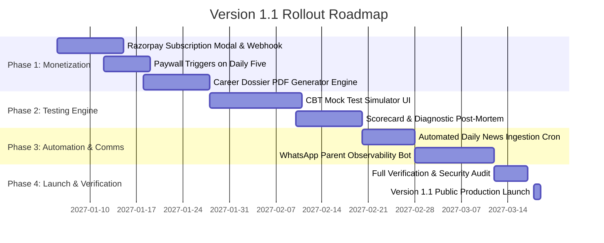

# LoopEdu — Version 1.1 Product Roadmap & Monetization Plan
**Target Release: Q1 2027**  
**Developer**: Blocks and Loops Technologies Pvt Ltd — Bangalore, Karnataka  
**Document Status**: Approved Planning Baseline (No changes applied to active code)

---

## 1. Executive Vision for Version 1.1
With **Version 1.0** established as a rock-solid, verified learning foundation, **Version 1.1** focuses on two strategic pillars:
1. **Aggressive, High-Converting Monetization**: Converting organic student & parent engagement into predictable recurring revenue via micro-SaaS subscriptions, one-time career blueprints, and parent observability add-ons.
2. **Autonomous Dynamic Intelligence**: Transitioning from curated static datasets to live-crawling official education feeds and offering full-scale 3-hour computer-based mock exams (CBT).

---

## 2. Monetization Strategy & Product Tiers

### A. Customer Persona Willingness-to-Pay Analysis
- **Indian Parents (Class 8–12)**: Spend between ₹30,000 to ₹2,50,000 annually on tuition centers, coaching, and reference books. They are resistant to paying for generic recorded videos, but readily pay **₹299–₹1,499** for:
  - Proven board exam question recurrence (eliminating fear of underperforming).
  - Concrete stream & entrance exam clarity (saving ₹15,000–₹25,000 on private career counselors).
  - Parental peace of mind that their child is completing focused 15-minute daily practice without smartphone addiction.
- **NRI / Global Indian Diaspora (GCC, US, UK, Singapore)**: Eagerly pay **$19–$49/mo** for an authentic curriculum platform that keeps their children competitive with Indian board and entrance standards (JEE/NEET/SAT).

### B. Monetization Architecture

| Tier / Offering | Pricing (INR) | Pricing (USD / NRI) | Billing Frequency | Unlocks & Privileges |
| :--- | :--- | :--- | :--- | :--- |
| **Free Explorer** | ₹0 | $0 | Free Forever | Daily 5 practice questions, basic stream advisor, global news feed. |
| **LoopEdu Pro (Single Subject)** | ₹299 / month | $9 / month | Monthly Recurring | Full 200-question verified bank for target subject, Socratic hints, Feynman voice audit, spaced retrieval. |
| **LoopEdu All-Access Annual Pass** | ₹1,499 / year | $49 / year | Annual Single-Pay *(Hero Offer)* | All 8 tracks, unlimited practice, 10-year recurring board questions, priority AI explanations, printable chapter cheat sheets. |
| **Comprehensive AI Career Blueprint PDF** | ₹499 | $19 | One-Time Purchase | 25-page individualized career & entrance exam report, college cutoffs, eligibility breakdown, and counseling checklist. |
| **Parent Observability Hub + WhatsApp Alerts** | ₹499 / year | $15 / year | Annual Add-On | Weekly Sunday WhatsApp progress summary, cognitive latency telemetry, and exam countdown alerts. |
| **B2B School / Coaching Center License** | ₹50 / student / mo | $2 / student / mo | B2B Annual Contract | White-labeled school exam prep portal, teacher assignment generator, classroom analytics. |

### C. Conversion Funnels & Paywall Triggers
1. **The "Daily Five" Completion Paywall**:
   - Once a student completes their 5th question of the day, an elegant modal appears:
     *"You've completed today's focus block! Unlock unlimited practice questions and full-length board exams with LoopEdu Pro (₹299/mo)."*
2. **The "Unlock Deep Career Report" CTA**:
   - On `/consultant`, the on-screen blueprint is free; students and parents can click *"Download 25-Page Comprehensive College & Exam Dossier (₹499)"* to receive a personalized PDF with past cutoffs for top colleges.
3. **Frictionless UPI Checkout**:
   - 1-click Razorpay checkout supporting Google Pay, PhonePe, Paytm, CRED, NetBanking, and International Credit/Debit Cards.

---

## 3. Planned Features for Version 1.1

### Feature 1: Timed CBT Mock Test Simulator (`app/mock-tests/`)
- **Full 3-Hour Examination Mode**:
  - Exact simulation of CBSE Class 10 Board Exam (80 marks, 3 hours) and JEE Main Paper 1 (300 marks, 75 questions).
  - Standard National Testing Agency (NTA) question navigation palette:
    - Green: Answered
    - Red: Unanswered
    - Purple: Marked for Review
    - Gray: Not Visited
- **Automated Diagnostic Post-Mortem**:
  - Pinpoints lost marks: *"3 marks lost due to sign miscalculation in Quadratic formula; 2 marks lost due to time pressure in Section E."*

### Feature 2: Automated Live Education News Crawler (`lib/news/crawler.ts`)
- **Automated Ingestion Pipeline**:
  - Daily scheduled cron running at 04:00 AM IST.
  - Automatically fetches official press releases and circulars from:
    - CBSE Academic (`cbseacademic.nic.in/circulars.html`)
    - National Testing Agency (`nta.ac.in/NoticeArchive`)
    - Ministry of Education (`education.gov.in`)
    - DAAD Germany, US Consular Bulletins, UK Visas & Immigration.
  - Cleans HTML, extracts dates, synthesizes 2-sentence student impact summaries, and links to original PDFs.

### Feature 3: WhatsApp Parent Notification Bot (`lib/notifications/whatsapp.ts`)
- **Automated Sunday Digest to Parents**:
  - Uses Meta WhatsApp Cloud API / Twilio to deliver weekly 60-second summaries:
    ```text
    📊 LoopEdu Weekly Digest for Arjun (Class 10)
    • Questions Completed: 35 / 35
    • Conceptual Accuracy: 92%
    • Top Strength: Linear Equations (100% accuracy, 1.4s speed)
    • Focus Area for this week: Light Reflection & Refraction
    • Streak: 7 Days Active 🔥
    View full observability dashboard: https://loopedu.in/parent
    ```

### Feature 4: High-Yield Printable Chapter Formula & Cheat Sheets (`/downloads`)
- 2-page condensed, beautifully typeset PDF formula sheets for each Class 10 chapter (Physics formulas, Chemistry reactions, Math theorems).
- Watermarked with student's name for copyright and privacy protection.

### Feature 5: Progressive Web App (PWA) & Offline Mode
- Service worker caching allowing students to practice downloaded questions on low-bandwidth mobile devices during commutes or school buses without constant internet access.

---

## 4. Technical Implementation Phases for v1.1



---

## 5. Security, Legal & Attribution Continuity
All Version 1.1 features will strictly maintain compliance with our verified baseline:
- `Blocks and Loops Technologies Pvt Ltd — Bangalore, Karnataka` corporate attribution in all footers and metadata.
- Clear disclaimers stating LoopEdu is an independent educational technology platform and not officially affiliated to any educational board.
- Protection against spreadsheet formula injection (CWE-1236) and customer email masking.
