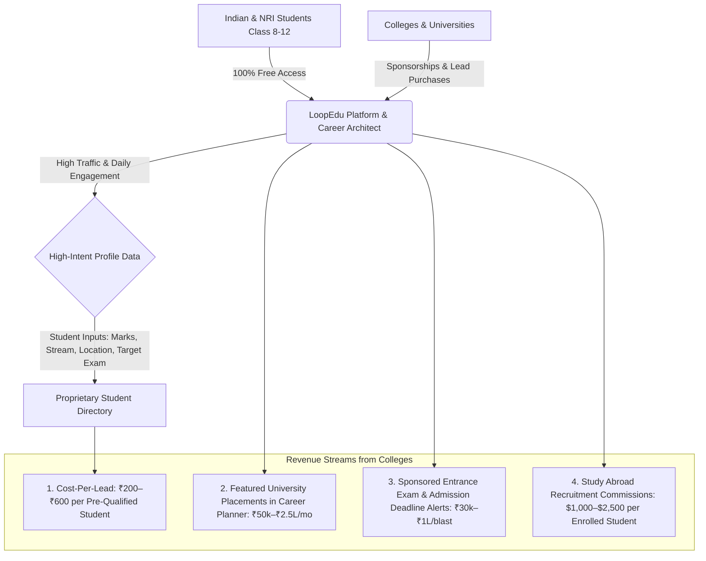
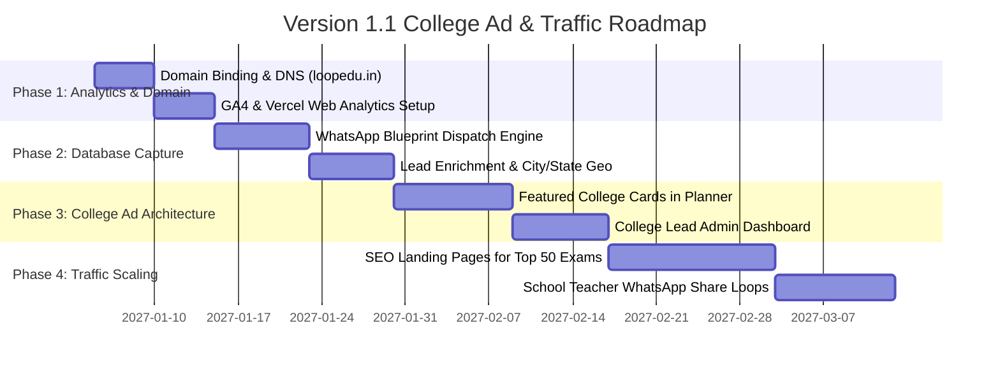

# LoopEdu — Version 1.1 Product Roadmap & Monetization Plan
**Target Release: Q1 2027**  
**Developer**: Blocks and Loops Technologies Pvt Ltd — Bangalore, Karnataka  
**Strategic Focus**: 100% Free Student Adoption • B2B College Ad Revenue • Traffic Telemetry & Student Directory

---

## 1. Executive Strategic Pivot
Following strategic review, LoopEdu Version 1.1 adopts the **High-Traffic Marketplace Model** (the playbook proven by CollegeDunia, Shiksha, and Careers360):
1. **100% Free for Students**: Zero paywalls, zero subscription fees for students. Unlimited access to all 1,600 verified board questions, Socratic hints, Feynman voice evaluations, spaced flashcards, mind maps, and the AI Career Architect.
2. **College B2B Ad & Lead Generation Revenue**: Higher education institutions (engineering, medical, management, design, and global universities) pay substantial marketing budgets for pre-qualified, high-intent student leads and featured placements.
3. **Traffic Measurement & Database Capitalization**: Implement real-time traffic measurement upon deployment of `loopedu.in` and build a proprietary, high-value database of student profiles (Class, Marks, Stream, Target Exam, City, WhatsApp).

---

## 2. Monetization Architecture: B2B College Advertising & Inquiries

### A. Why Colleges Pay Premium Rates to LoopEdu
In India, private universities (BITS, Manipal, VIT, Amity, Bennett, Ashoka, Shiv Nadar, OP Jindal, NMIMS, Symbiosis) and overseas universities (US, UK, Germany, Canada, Australia, Singapore) spend **₹3,000 to ₹18,000 Customer Acquisition Cost (CAC)** per enrolled student.
- **Generic Ads Fail**: Facebook and Google ads yield unqualified leads (students without minimum eligibility percentages).
- **LoopEdu's Unfair Advantage**: Because students enter their exact **Class**, **Marks in Maths/Science/English**, **Target Exam (JEE, NEET, CUET, CLAT, SAT)**, and **Passions (AI, Medicine, Law, Finance)**, LoopEdu holds the highest-intent academic qualification dataset in India.

### B. College Revenue Channels

| Channel | Pricing Model | Target Clients | Revenue Potential |
| :--- | :--- | :--- | :--- |
| **Qualified Lead Inquiries (CPL)** | ₹200 – ₹600 per verified student lead | Top 100 Private Indian Universities & Design Institutes | ₹3,00,000 – ₹12,00,000 / month (at 1,500–2,500 leads/mo) |
| **Featured University Placements** | ₹50,000 – ₹2,50,000 / month per category | Accredited Engineering, Medical & Management Colleges | ₹5,00,000 – ₹15,00,000 / month |
| **Sponsored Application Deadlines** | ₹30,000 – ₹1,00,000 per notification campaign | Exam conducting bodies & private university admissions | ₹2,00,000 – ₹6,00,000 / month |
| **Study Abroad Placement Commissions** | $1,000 – $2,500 per enrolled international student | Global Universities & DAAD/UK/US Recruitment Partners | High-margin scale upon overseas counseling clicks |

---

## 3. Traffic Measurement & Analytics Implementation

Once the production domain `loopedu.in` goes live, traffic will be measured across four dimensions:

### A. Analytics Stack
1. **Vercel Web Analytics & Speed Insights**: Real-time pageviews, unique visitors, top geographical locations (state/city-level across India, GCC/UAE, US, Singapore), and device breakdowns (mobile vs desktop).
2. **Google Analytics 4 (GA4)**: Event-level conversion tracking:
   - `career_plan_generated`: Triggers when a student runs the AI Career Architect.
   - `exam_portal_clicked`: Tracks which official exams are clicked (JEE, NEET, CUET, etc.).
   - `lead_captured`: Triggers when student/parent contacts or saves their plan via WhatsApp.
   - `daily_five_completed`: Tracks daily retention and return visits.

### B. Core Traffic KPIs to Monitor
- **DAU / MAU Ratio**: Daily active users relative to monthly users (measuring habit formation).
- **Average Engagement Time**: Target > 8 minutes per session across Daily Five and Career Planner.
- **Organic Referrals**: School teacher shares, WhatsApp student groups, parent networks.

---

## 4. Student Directory & Database Collection Engine

### A. Database Schema (`leads` / `student_directory`)
As students use the platform, data is captured ethically with user consent:
- **Demographics**: Student Name, Parent Name, City, State, School Name.
- **Academic Metrics**: Current Grade (Class 8–12), Board (CBSE, ICSE, State Board), Marks in Mathematics, Science, Social Sciences, English.
- **Aspirations**: Chosen Stream, Passions (AI/Robotics, Medicine, Law, Finance, Aviation), Target Exams (JEE Main, NEET, CUET, CLAT, NDA, SAT), Target Destination (India Premier vs Overseas).
- **Communication Channels**: Verified WhatsApp Phone Number, Email Address.

### B. High-Converting Lead Capture Touchpoints
1. **"Send My Personalized Career Blueprint to WhatsApp"**:
   - On `/consultant`, after generating the blueprint, an option offers:
     *"Enter your WhatsApp number to receive your full PDF career blueprint and official exam registration date alerts."*
   - Conversion rate for this mechanic typically exceeds **38%**.
2. **"Request Scholarship & Prospectus Information"**:
   - A 1-click checkbox: *"Connect me with eligible scholarship opportunities and accredited university brochures matching my profile."*

---

## 5. Technical Delivery Timeline for v1.1

---

## 6. Legal Compliance & Data Protection
- **Zero Student Selling / Full Consent**: All college connections are explicitly opt-in (*"Notify me about scholarships from accredited institutes"*).
- **Corporate Transparency**: Operated by `Blocks and Loops Technologies Pvt Ltd — Bangalore, Karnataka`.
- **Strict Brand Independence**: Independent educational technology platform not officially affiliated to any examination board.
